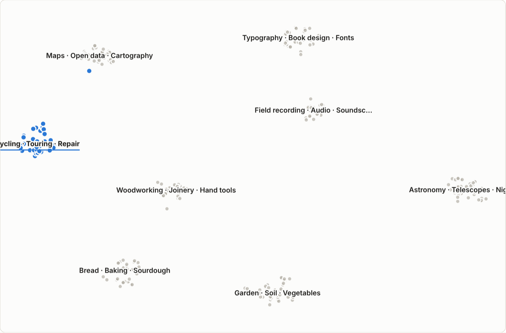
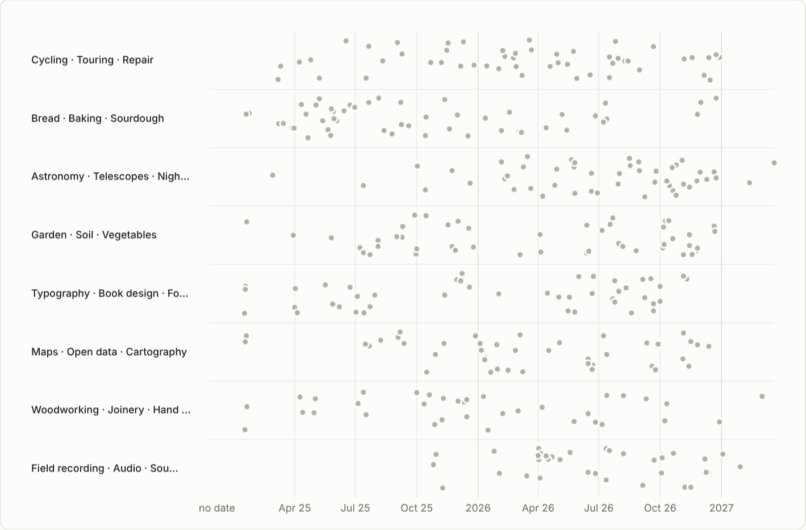
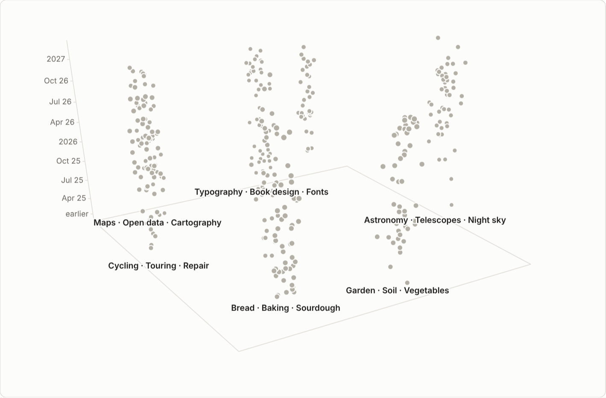
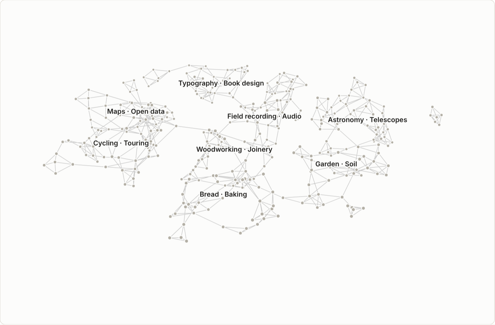
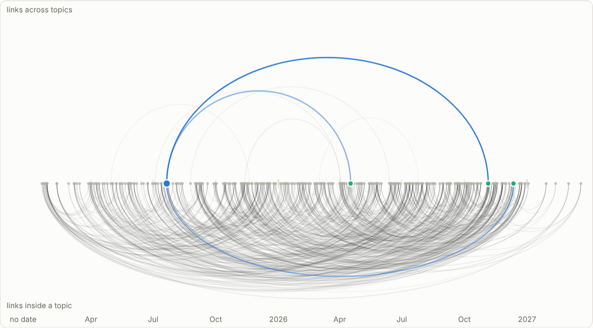
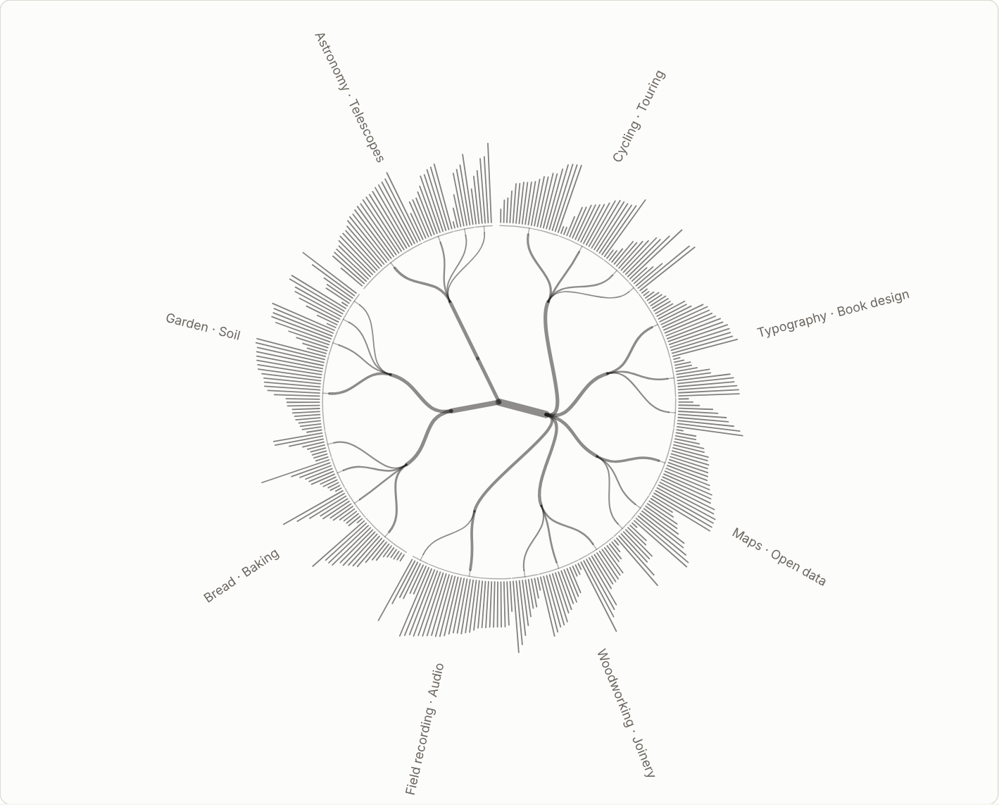
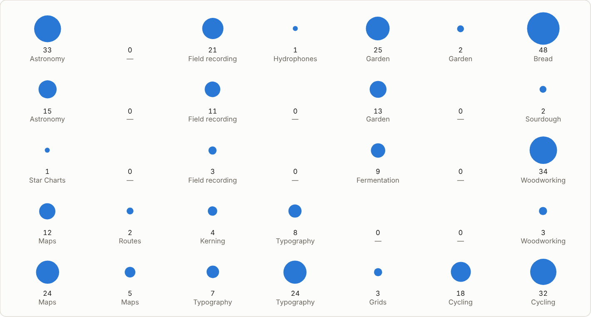
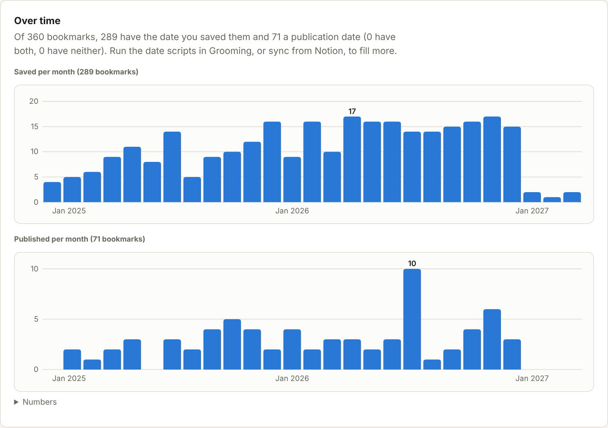

# Bookmark Atlas

A desktop app to explore and refine a bookmark collection: clustering, maps,
nested collections and trends, built to encourage discovery.

Atlas is the final database. Bookmarks (with summaries and tags) arrive from a
Notion table, which is only an inbox and an optional outbox. The local SQLite
file is the reference, and it is cleaned with grooming scripts run from the
interface.

It is also a test bed for **e-means**, a clustering algorithm published in
November 2026 ([arXiv 2611.09501](https://arxiv.org/abs/2611.09501)).

## What it looks like

These pictures were taken from an invented collection (`tools/demo_collection.py`), not from anyone's bookmarks.

| | |
|---|---|
|  **Map.** Similar bookmarks sit close together. |  **Timeline.** One row per topic. |
|  **Space and time.** The map lies flat, time is the height. |  **Links (3D).** Each bookmark tied to its three closest. |
|  **Threads.** An arc between two bookmarks that resemble each other. |  **Tree.** Families, topics, and one stroke per bookmark. |
|  **Grid.** Where the collection is dense. |  **Trends.** Saved and published per month. |

## Status

Everything planned is published. Import (Notion or CSV), browse, groom the
collection with scripts, group it into topic clusters, explore it on a map, on
a grid and as a tree of topics, follow the links between bookmarks, see what
is rising, save views, and share or compare snapshots. The e-means test is
done: see [docs/reports/e-means-test.md](docs/reports/e-means-test.md).

What has been used for real, and what has not:

- **Used for real:** the Windows app and its self-update, the Notion sync with
  a real token, the CSV import (a 962-row export).
- **Started by the build, not yet used by a person:** the Linux and macOS
  builds.
- **Tested with stand-in pages only:** the two features that read the web
  (publication dates, link check).

- Summary of each phase: [docs/PHASES.md](docs/PHASES.md)
- Where development stands: [docs/DEVLOG.md](docs/DEVLOG.md)
- Where it is going: [docs/IMPLEMENTATION_PLAN.md](docs/IMPLEMENTATION_PLAN.md)

## Install

### Windows

1. Open the [latest release](https://github.com/b2renger/Bookmark-atlas/releases/latest)
   and download `Bookmark-Atlas-Setup-<version>-windows-x64.exe`.
2. Run it. The installer is not signed, so Windows shows "Windows protected
   your PC" the first time: choose **More info**, then **Run anyway**.
3. The app opens. Nothing else to install: Python is included.

The app updates itself. It checks GitHub Releases at start, downloads a new
version in the background and offers to restart. **Atlas > Check for updates…**
checks on demand.

### Linux

Download `Bookmark-Atlas-<version>-linux-x64.AppImage` from the
[latest release](https://github.com/b2renger/Bookmark-atlas/releases/latest),
make it executable (`chmod +x`) and run it. It updates itself like the Windows
build.

### macOS (Apple silicon)

Download the `.dmg` from the
[latest release](https://github.com/b2renger/Bookmark-atlas/releases/latest)
and drag the app to Applications. The app is not signed by Apple (that needs a
paid developer account), so the first time macOS refuses to open it:
right-click the app and choose **Open**, or allow it in **System Settings >
Privacy & Security**. This build does not update itself: **Check for
updates…** opens the download page. There is no build for Intel Macs.

### Your data folder

Everything you own is in one folder: the bookmarks (`atlas.sqlite`), your
grooming scripts, the backups and the Notion token. By default it is
`%APPDATA%\Bookmark Atlas`. Settings shows the current place, and
**Atlas > Open data folder** opens it. Updates and uninstalling leave it alone.

- **Put it elsewhere:** **Atlas > Choose data folder…** copies your data to
  the folder you pick (another disk, a synced drive) and uses it from then on.
  The original stays in place as a safety copy.
- **Change computer:** copy the folder to the new machine, install Bookmark
  Atlas there, and choose the folder with the same menu.
- The folder holds your Notion token. Do not hand it to someone else; to share
  bookmarks, use Export selection.

macOS and Linux builds are not produced yet.

## Use it

In **Settings** you can load data two ways, and combine them:

- **Import a CSV file**: an export of the table from Notion. No token needed.
- **Notion**: connect with a token, pick the table, import. Later imports only
  fetch rows edited since.

In **Bookmarks**, tick rows (or "select all matching" a search) to add or
remove a tag, delete, or **export the selection** as a file another Atlas user
can import from Settings.

The **Map** draws every bookmark as a dot, similar ones close together, with
topic names on top. Hover and click to read, click a topic to focus it, type
to highlight matches, Shift+drag to select an area.

In **Clusters**, group the collection by topic. Each cluster shows its telling
tags and a few bookmarks; rename it, or "show bookmarks" to work on it in the
list.

A **filter bar** sits above the list, the map, the grid, the tree, the links
and the trends: tags, site, and a range of dates (saved, published, or saved
with published as a fallback). What you set there applies everywhere.

**Threads** (in Links) puts every bookmark on one line and draws an arc between
two that resemble each other: above the line when the link crosses topics,
below when it stays inside one. "Surprise me" jumps to a link you would not
have looked for. The **Tree** tab also draws the whole tree at once, with one
stroke per bookmark on the rim.

On the **Map**, "Arrange by" moves the same dots between four layouts, with an
animation: by similarity, along a timeline with one row per topic, on the
grid, or in 3D with the map lying flat and time rising from it (drag to turn).
**Play** replays the collection as it grew; the slider goes to any day.

The **Grid** is a self-organising map: every bookmark sits in one cell,
neighbouring cells hold related bookmarks, and a larger disc means more
bookmarks. It shows where the collection is dense. Click a cell to read it,
select it or open it in the list.

The **Tree** gathers close topics into families and splits large topics into
parts. Open a pearl to go inside; rename anything; move a topic to another
family.

In **Grooming**, "Look up publication dates" opens the pages of bookmarks that
have no publication date and reads the date each page declares. It changes
nothing by itself: the script "Publication date read from the page" then
proposes the dates for review. This is the only part of the app, with the
Notion sync and the update check, that goes online.

**Links** shows which topics share the most similar bookmarks, the bookmarks
that sit between two topics, those that resemble nothing else, and old
bookmarks close to what you gathered lately. In the list, "similar bookmarks"
under any bookmark shows its nearest neighbours.

**Trends** shows bookmarks saved and published per month, how long after
publication you save things, and which topics and tags take more or less room
in the last 90 days.

**Workspaces** are copies of part of your collection that live apart: their
own tags, topics, map, views, grooming history and Notion table. Start one
from a filter, a selection, a topic, everything, or nothing; bring data in
from a CSV, a bundle, a snapshot, another Notion table or a browser's
bookmarks file; then merge it back (merging only adds) or delete it. They are
kept in `Workspaces/` inside your data folder.

In **Views**, save where you are under a name and come back to it later, or
export a **snapshot**: one file with bookmarks, clusters, map and views that
someone else opens with **Atlas > Open snapshot…**, without touching their own
collection.

Then clean it in **Grooming**: merge duplicates, merge tag spellings, set
platforms and fix dates. Every script shows a preview first, makes a backup
before writing, and can be undone. You can add your own scripts: see
[docs/GROOMING.md](docs/GROOMING.md).

### Connect Notion

In **Settings**:

1. **Token.** Create one in Notion's Developer portal and paste it. Either kind
   works:
   - a *personal access token* sees what you can see, with nothing to share;
   - an *internal connection* token sees only what is shared with the
     connection. Share the bookmarks database with it, from the connection's
     Content access tab or from the database's ••• menu under Connections.

   The token is checked with Notion before it is stored, and it is stored on
   your computer outside the database file.
2. **Table.** List the tables the token can see and pick yours.
3. **Columns.** Check the guessed mapping. Only the link column is required.
4. **Import.** *Preview* shows what would happen without writing anything.
   *Import now* does it. Later imports only ask Notion for rows edited since.

### What an import does

- A link not seen before becomes a bookmark.
- A row edited in Notion later is kept for review. It never overwrites what is
  in the database.
- A bookmark you deleted stays deleted.
- Importing again changes nothing if Notion has not changed.

Links are compared after normalisation, so `twitter.com` and `x.com`, tracking
parameters, or a trailing slash do not create duplicates.

## For developers

Needs Python 3.11 or later; the backend uses the standard library only.

```sh
python3 -m pip install -e ".[analysis]"
atlas ui                                # the interface, in your browser
python -m pytest
ruff check . && ruff format --check .
```

Everything the interface does is also a command:

```sh
atlas init                              # create or upgrade the database
atlas import-csv export.csv --dry-run   # a Notion CSV export, report only
atlas import-csv export.csv
atlas notion token                      # enter the token (input hidden)
atlas notion tables                     # list tables with their IDs
atlas notion select <table-id>
atlas sync --dry-run
atlas sync                              # --full reads the whole table again
atlas status
atlas export --format json -o bookmarks.json
atlas groom list                        # grooming scripts
atlas groom preview normalize-tags      # what it would change
atlas groom apply normalize-tags
atlas groom undo last
atlas cluster                           # group by topic (needs numpy)
atlas compare                           # e-means against k-means on your data
atlas doctor                            # check the installation and Notion access
```

The database path is `data/atlas.sqlite`, or `$ATLAS_DB`, or `--db PATH`. The
`data/` folder is ignored by git, so bookmarks never end up in the repository.
The token can also be given as the `NOTION_TOKEN` environment variable.

### Desktop app and releases

`desktop/` is an Electron shell. It starts the Python backend, shows its page
in a window and updates itself with electron-updater, the same way ComfyQ and
LlmOnLan do. The installer bundles a standalone Python, so users install
nothing else.

- **Release:** in the Actions tab, run the `release` workflow and type a
  version such as `0.3.0`. It runs the tests, builds the installer, starts the
  packaged app to check it works, creates the tag and publishes the release
  with the update manifest. Pushing a tag `vX.Y.Z` does the same.
- **Trial build:** run the workflow with the version left empty. The installer
  is attached to the run and nothing is published.
- Self-update reads public GitHub Releases, so it needs the repository to stay
  public.

## Planned shape

- **Import**: incremental import from Notion through its API, or from a CSV
  export. Imports never overwrite local curation.
- **Local store**: one SQLite file, exportable to CSV and JSON.
- **Grooming**: scripts for duplicates, tags and dates, each with preview,
  journal and undo.
- **Analysis**: embeddings, e-means (with k-means as a baseline), 2D projection,
  self-organising map.
- **Views**: map, SOM grid, pearl tree, link graph, tendencies over time.
- **Snapshots**: saved runs and views, exportable as a single shareable file.
