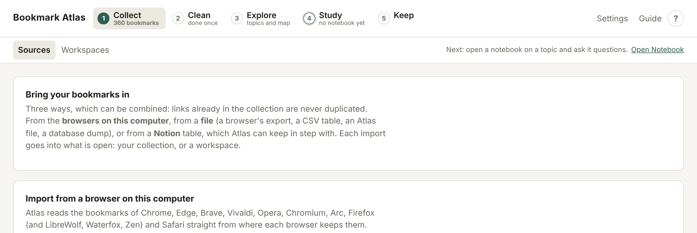
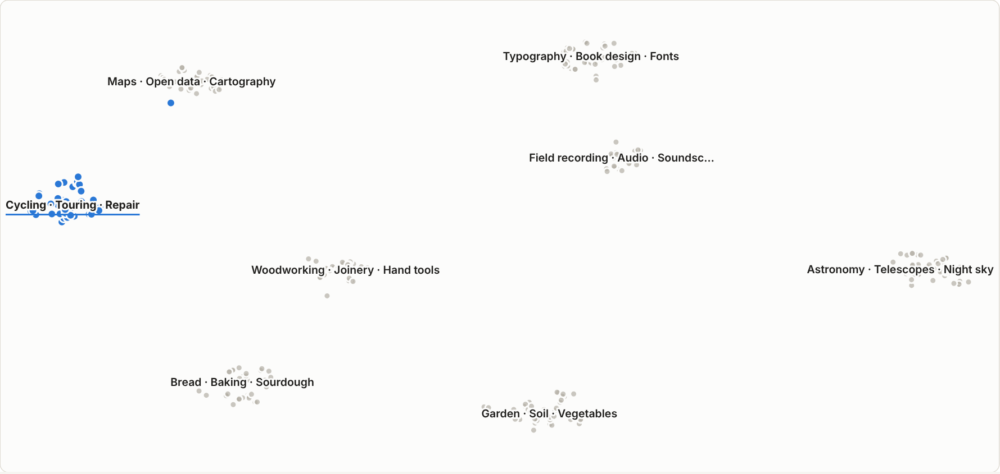
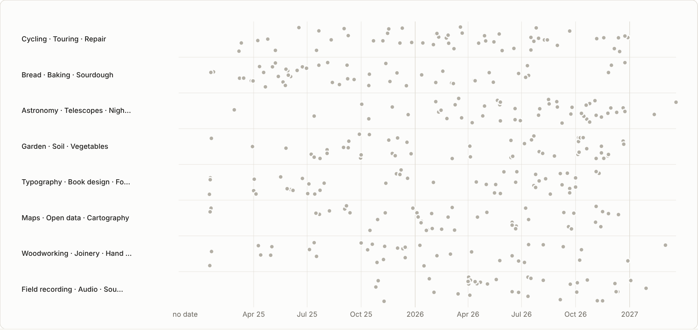
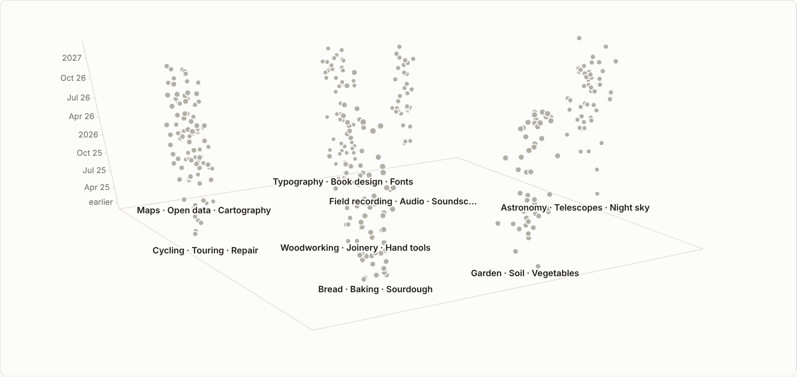
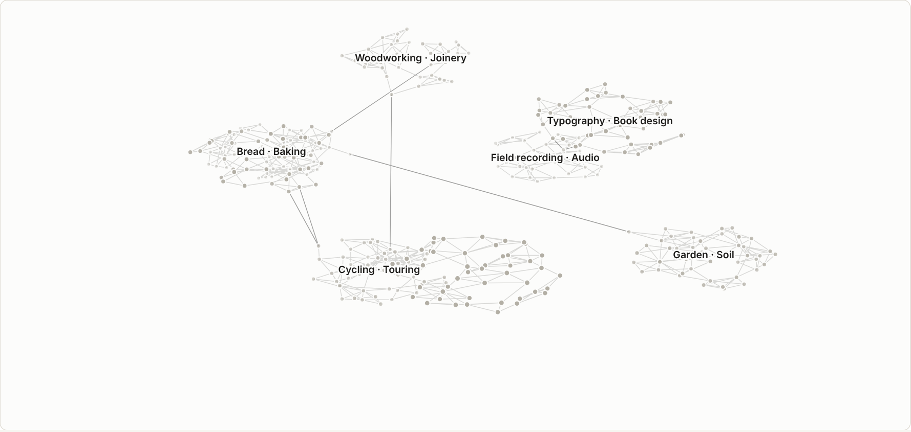
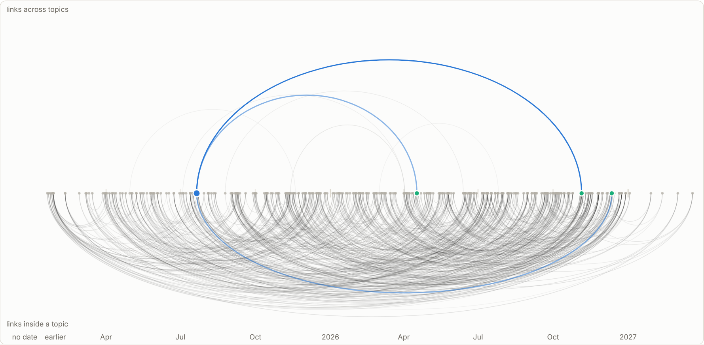
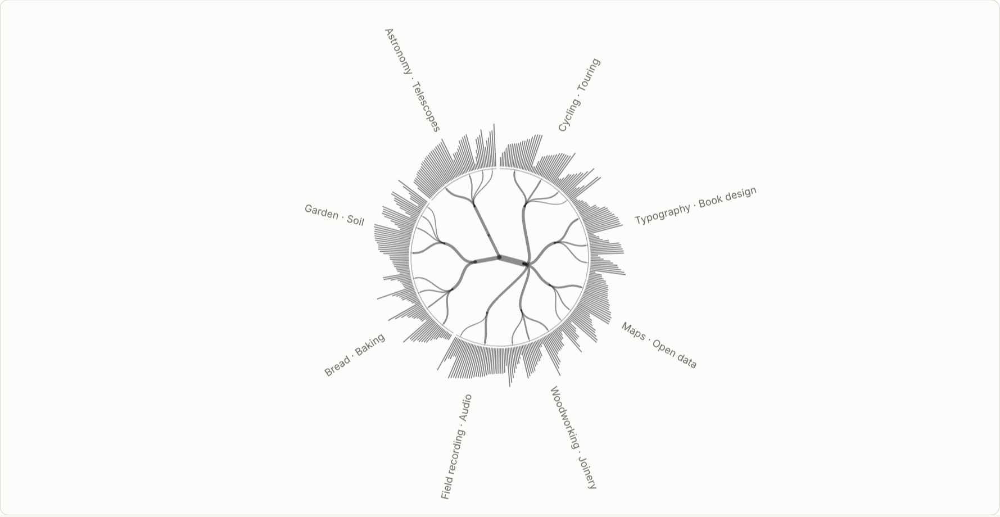
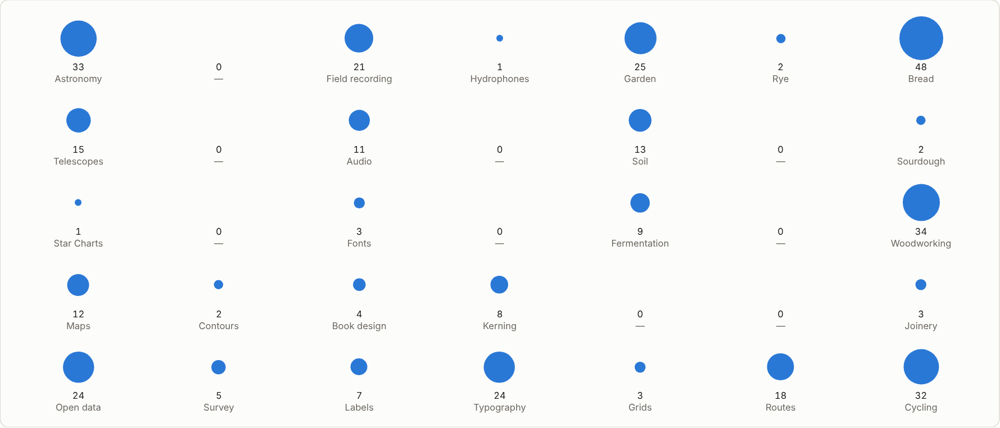
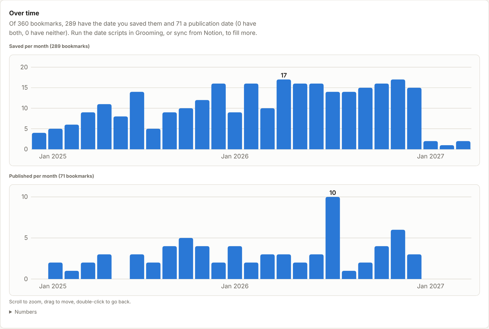
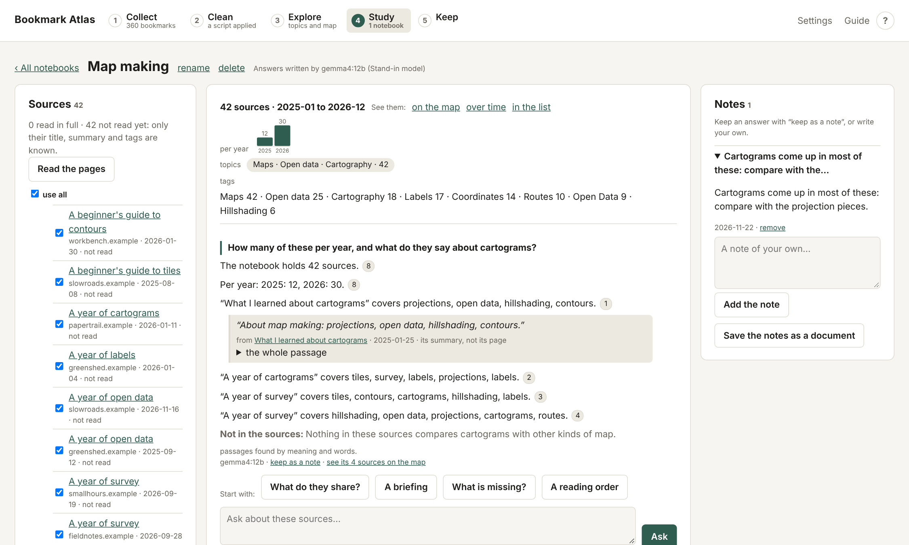

# Bookmark Atlas

A desktop app to explore, clean and study a bookmark collection: topics, maps,
a tree, links, trends, and notebooks where a language model answers from your
sources and must quote them.

Your collection lives in one SQLite file on your computer. Bookmarks arrive
from the browsers on the computer, from files, or from a Notion table; Atlas
is where they are kept, cleaned and read. Nothing is sent anywhere unless you
start it ([what goes online](#privacy-and-what-goes-online)).

It is also a test bed for **e-means**, a clustering algorithm published in
November 2026 ([arXiv 2611.09501](https://arxiv.org/abs/2611.09501)); the
result is in [docs/reports/e-means-test.md](docs/reports/e-means-test.md).

## What it looks like

These pictures were taken from an invented collection (`tools/demo_collection.py`), not from anyone's bookmarks.



| | |
|---|---|
|  **Map.** Similar bookmarks sit close together. |  **Timeline.** One row per topic. |
|  **Space and time.** The map lies flat, time is the height. |  **Links (3D).** Each bookmark tied to its three closest. |
|  **Threads.** An arc between two bookmarks that resemble each other. |  **Tree.** Families, topics, and one stroke per bookmark. |
|  **Grid.** Where the collection is dense. |  **Trends.** Saved and published per month. |

## Install

### Windows

1. Open the [latest release](https://github.com/b2renger/Bookmark-atlas/releases/latest)
   and download `Bookmark-Atlas-Setup-<version>-windows-x64.exe`.
2. Run it. The installer is not signed, so Windows shows "Windows protected
   your PC" the first time: choose **More info**, then **Run anyway**.
3. The app opens. Nothing else to install: Python is included.

The app updates itself. It checks GitHub Releases at start, downloads a new
version in the background and offers to restart. **Atlas > Check for updates…**
checks on demand.

### Linux

Download `Bookmark-Atlas-<version>-linux-x64.AppImage` from the
[latest release](https://github.com/b2renger/Bookmark-atlas/releases/latest),
make it executable (`chmod +x`) and run it. It updates itself like the Windows
build.

### macOS (Apple silicon)

Download the `.dmg` from the
[latest release](https://github.com/b2renger/Bookmark-atlas/releases/latest)
and drag the app to Applications. The app is not signed by Apple (that needs a
paid developer account), so the first time macOS refuses to open it:
right-click the app and choose **Open**, or allow it in **System Settings >
Privacy & Security**. This build does not update itself: **Check for
updates…** opens the download page. There is no build for Intel Macs.

### Your data folder

Your collection is in one folder: the bookmarks (`atlas.sqlite`), your
grooming scripts, the backups and the workspaces. By default it is
`%APPDATA%\Bookmark Atlas` on Windows, and the app's own settings folder on
macOS and Linux. Settings shows the current place, and
**Atlas > Open data folder** opens it. Updates and uninstalling leave it alone.

- **Put it elsewhere:** **Atlas > Choose data folder…** copies your data to
  the folder you pick (another disk, a synced drive) and uses it from then on.
  The original stays in place as a safety copy.
- **Change computer:** copy the folder to the new machine, install Bookmark
  Atlas there, and choose the folder with the same menu.
- The Notion token and the keys of language models are **not** in this folder.
  They stay on the computer: in the system keychain when there is one, else in
  a private file of the app. On a new computer you enter them again.
  (Up to 0.26.0 they were written to `secrets.json` in this folder. 0.26.1
  moves them out at its first start and deletes that file. If the folder was
  synced or copied somewhere in the meantime, renew those keys.)
- The folder is your whole collection. To share part of it, use Export
  selection.

## First use

The top of the window follows the path your bookmarks take, in five numbered
stages. Each says where you stand, the suggested next one is underlined, and
the row under it holds that stage's screens and a one-line suggestion:

1. **Collect** (Sources): bring bookmarks in.
2. **Clean** (Grooming): duplicates, tags, dates, with preview and undo.
3. **Explore**: Bookmarks, Map, Topics, Grid, Tree, Links, Trends.
4. **Study** (Notebook): question a set of bookmarks with a language model.
5. **Keep** (Views, Workspaces): save, share, work on a copy.

Nothing forces the order. An empty collection opens on Collect, with five
**getting-started steps** that tick themselves off. Settings (data folder,
language models) and the **Guide** sit at the top right; the **?** opens the
Guide's section for the screen you are on.

## The five stages

### 1. Collect

Three ways in, which can be combined. A link already in the collection is
never duplicated: links are compared after normalisation, so `twitter.com`
and `x.com`, tracking parameters or a trailing slash do not make two.

- **A browser on this computer** (Chrome, Edge, Brave, Vivaldi, Opera,
  Chromium, Arc, Firefox and its relatives, Safari): its bookmarks are read
  where the browser keeps them. Folders become tags. Only bookmarks are read.
- **A file**: a CSV exported from Notion, a browser's bookmarks file, a bundle
  exported by another Atlas, or a MySQL/MariaDB dump (`.sql`) of a site that
  kept links. A dump goes into a workspace of its own: links, titles,
  descriptions, dates and tags only, never accounts.
- **A Notion table**, in four steps on the same screen:
  1. **Token.** Create one in Notion's Developer portal and paste it. A
     *personal access token* sees what you can see; an *internal connection*
     token sees only what is shared with the connection (share the database
     with it). The token is checked with Notion before it is kept.
  2. **Table.** List the tables the token can see and pick yours.
  3. **Columns.** Check the guessed mapping. Only the link column is required.
  4. **Import.** *Preview* shows what would happen and writes nothing.
     *Import now* does it. Later imports only ask for rows edited since.

What an import does: a link not seen before becomes a bookmark; a row edited
in Notion later is kept for review and never overwrites what you have; a
bookmark you deleted stays deleted; importing again changes nothing if the
source has not changed.

### 2. Clean

**Grooming** runs scripts on the collection: merge duplicates, merge tag
spellings, set platforms, fix dates. Every script shows a preview first,
makes a backup before writing, and can be undone from the history. You can
add your own: see [docs/GROOMING.md](docs/GROOMING.md).

Two lookups go online, only when you press them: *Look up publication dates*
reads the date each page declares, and *Check the links* asks whether each
page still answers. Neither changes a bookmark: a script then proposes what
they found, for review.

### 3. Explore

A **filter bar** sits above every screen of this stage: tags, site, and a
range of dates (saved, published, or saved with published as a fallback).
What you set there applies everywhere.

- **Bookmarks**: the list. Search, tick rows (or "select all" of what the
  search and filters show) to add or remove a tag, delete, export the
  selection as a file another Atlas can import, or start a notebook.
- **Topics**: one press groups similar bookmarks and names each group after
  its telling tags. Rename a topic, or open it in the list.
- **Map**: every bookmark is a dot, similar ones close together, topic names
  on top. Click a topic to focus it, type to highlight, Shift+drag to select
  an area. "Arrange by" moves the same dots between five layouts: similarity,
  a timeline with one row per topic, the grid, space and time in 3D (the map
  lying flat, time rising from it), and links in 3D. **Play** replays the
  collection as it grew.
- **Grid**: a self-organising map. Neighbouring cells hold related bookmarks
  and a larger disc means more of them: it shows where the collection is dense.
- **Tree**: close topics gathered into families, large topics split into
  parts. Open a pearl to go inside, rename anything, move a topic. The whole
  tree can also be drawn at once, one stroke per bookmark.
- **Links**: which topics share the most similar bookmarks, the bookmarks
  between two topics, those that resemble nothing else, and old bookmarks
  close to what you gathered lately. **Threads** puts every bookmark on one
  line with an arc between two that resemble each other; "Surprise me" jumps
  to a link you would not have looked for.
- **Trends**: bookmarks saved and published per month, how long after
  publication you save things, and which topics and tags take more or less
  room in the last 90 days.

Every picture can be zoomed and moved (scroll, drag, double-click to go
back). Every bookmark named anywhere opens a **side panel** with its summary,
tags and the bookmarks most like it; Ctrl+click goes straight to the page.

### 4. Study

A **notebook** is a set of bookmarks (a topic, a selection, what the filter
shows), a conversation about them, and the notes you keep: sources on the
left, the conversation in the middle, notes on the right.

- Atlas finds the passages closest to each question on your own computer.
- The model answers from those only, and must quote the words each statement
  rests on.
- Atlas checks the quote is in the source, word for word and within one
  sentence, and sets aside what fails. The check proves the words are there,
  not that they are the right proof: read the quote.
- When the sources do not answer, the answer says so instead of guessing.
- Notes export as a Markdown document with quotes and sources.

The notebook is tied to the pictures. Above the conversation it shows the
set's figures, counted by Atlas and not by the model: how many sources, over
which months, a bar per year, their topics and tags, with **see them on the
map / over time / in the list** and a way back. A question about the set
itself ("how many per year?") is answered from those figures and says so.
Under an answer, **see its sources on the map** selects the bookmarks it
rests on.



(The answers in this picture come from a stand-in model that only lifts sentences from the passages.)

A notebook needs a language model: see [Language models](#language-models).

### 5. Keep

- **Views**: save where you are under a name and come back to it.
- **Snapshots**: one file with bookmarks, topics, map and views that someone
  else opens with **Atlas > Open snapshot…**, without touching their own
  collection. A snapshot of *part* of the collection carries nothing about
  the rest: no saved view, no name or note of a topic none of its bookmarks
  belongs to.
- **Workspaces**: copies of part of your collection that live apart, with
  their own tags, topics, map, views, grooming history and Notion table.
  Start one from a filter, a selection, a topic, everything or nothing; then
  merge it back (merging only adds) or delete it.

## Language models

Optional, and needed only for notebooks and the jobs listed below. Set one up
in **Settings ▸ Language models**. Every connection you set up is kept; with
two or more, **Answered by** in a notebook sends one question to the model
you choose, and each answer names the model that wrote it.

- **On this computer.** The app ships llama.cpp. Download one of three sizes
  (0.8, 3.1 or 5.0 GB; the page suggests one for your memory) and press
  **Use**: nothing leaves the computer. A fourth small model gives vectors
  (finding by meaning); it is the one a LlmOnLan farm serves, so vectors carry
  over to a farm. Without a graphics card an answer takes from half a minute
  to a few minutes. Each file is pinned by size and SHA-256 and installed
  only when whole.
- **On your network.** A [LlmOnLan](https://github.com/b2renger/LlmOnLan)
  farm, found by itself, or any server that speaks the OpenAI API (Ollama,
  llama.cpp, vLLM, LM Studio).
- **A provider with an API key**: Claude, OpenAI, Gemini or Mistral. What is
  sent then leaves your computer and each request is billed to your key.
  Claude offers no vectors; the other three do.

What a model does besides notebooks:

- **Place bookmarks by meaning**: its vectors replace word counts for the
  map, topics, links and "similar bookmarks", so French and English bookmarks
  on one subject meet.
- **Rewrite summaries and tags** (Grooming): pages are read again, the model
  writes, and two scripts propose the changes to preview, apply and undo.
- **Compare then and now** (Grooming): is each page still what its summary
  says? A script tags the ones that changed.
- **Find tags that mean the same** (Grooming), proposed as merges.
- **Suggest names** for topics, and say **why** two bookmarks are alike.

Nothing a model writes changes a bookmark without a preview. A request that
fails records nothing and is tried again by the next run.

## Privacy and what goes online

- **Your collection** is one folder on your computer. The app's page is
  served to this computer only, and only to the app's own window.
- **Secrets** (the Notion token, model passwords and API keys) are not in
  that folder, the database, a snapshot or an export. They are kept in the
  system keychain (Windows Credential Manager, macOS Keychain, a Linux secret
  service), or, where none answers, in a private file of the app. Settings
  says which. A key is only sent to the address it was typed for, and never
  follows a redirect.
- **What goes online, and only when you start it:** the Notion import; the
  two lookups in Grooming; reading pages for a model or a notebook; the
  download of a model; requests to the model you connected; and, at start,
  the check for a new version on GitHub.
- **Pages are fetched from the public web only.** A link to an address inside
  your own network (a router, an intranet) is left alone, however it is
  written and wherever a redirect leads.
- **What a model receives:** titles, summaries and tags; page text for
  summaries; for a notebook, the passages found for the question and the
  conversation. With a model on this computer or your network, that stays
  there; with a provider, it goes to the provider.
- **Builds:** the Python, the llama.cpp program and the models the app
  downloads are pinned by SHA-256, and the npm packages by a lockfile. The
  installers are not signed (see Install).

## Status

Version 0.27.0. Summary of each phase: [docs/PHASES.md](docs/PHASES.md).
Where development stands: [docs/DEVLOG.md](docs/DEVLOG.md). The plan the
project started from, kept for the record:
[docs/IMPLEMENTATION_PLAN.md](docs/IMPLEMENTATION_PLAN.md).

What has been run for real, and what has not:

- **Used by a person:** the Windows app and its self-update, the Notion
  import with a real token, the CSV import (a 962-row export).
- **Run on the build machines, not yet by a person:** the Linux and macOS
  apps (started and their page loaded); the keychain on Windows and macOS
  (a value stored, read back and deleted); the built-in engine with the
  Light and Vectors models on Linux (one notebook question answered).
- **Tested with stand-ins only:** a LlmOnLan farm, the four providers, the
  browsers' own files, and the two features that read the web.
- **Never run:** the Medium and Advanced models; any model on Windows or
  macOS; a Linux desktop keychain.

In November 2026 three reviewers that had not seen the code being written
went through the repository. What they found, and what was done about it, is
in phases 29 and 30 of [docs/PHASES.md](docs/PHASES.md), with the limits that
remain.

## For developers

Needs Python 3.11 or later. The backend uses the standard library; NumPy is
needed for topics and maps, and `keyring` (optional) puts secrets in the
system keychain.

```sh
python3 -m pip install -e ".[analysis,keychain]"
atlas ui                                # the interface, in your browser (the address it prints carries a key)
python -m pytest
ruff check . && ruff format --check .
```

Everything the interface does is also a command:

```sh
atlas init                              # create or upgrade the database
atlas import-csv export.csv --dry-run   # a Notion CSV export, report only
atlas import-csv export.csv
atlas import-browser                    # the browsers found on this computer
atlas import-browser 1                  # import the first one's bookmarks
atlas import-sql old_site.sql --dry-run # a MySQL/MariaDB dump: what it holds
atlas import-sql old_site.sql --name "Old site"   # its links, into a new workspace
atlas notion token                      # enter the token (input hidden)
atlas notion tables                     # list tables with their IDs
atlas notion select <table-id>
atlas sync --dry-run
atlas sync                              # --full reads the whole table again
atlas status
atlas export --format json -o bookmarks.json
atlas groom list                        # grooming scripts
atlas groom preview normalize-tags      # what it would change
atlas groom apply normalize-tags
atlas groom undo last
atlas cluster                           # find the topics (needs numpy)
atlas compare                           # e-means against k-means on your data
atlas doctor                            # check the installation and Notion access
```

The database path is `data/atlas.sqlite`, or `$ATLAS_DB`, or `--db PATH`. The
`data/` folder is ignored by git, so bookmarks never end up in the repository.
The token can also be given as the `NOTION_TOKEN` environment variable.

### Desktop app and releases

`desktop/` is an Electron shell. It starts the Python backend, shows its page
in a window and updates itself with electron-updater, the same way ComfyQ and
LlmOnLan do. The installer bundles a standalone Python, so users install
nothing else.

- **Release:** in the Actions tab, run the `release` workflow and type a
  version such as `0.3.0`. It runs the tests, builds the installer, starts the
  packaged app to check it works, creates the tag and publishes the release
  with the update manifest. Pushing a tag `vX.Y.Z` does the same.
- **Trial build:** run the workflow with the version left empty. The installer
  is attached to the run and nothing is published.
- Self-update reads public GitHub Releases, so it needs the repository to stay
  public.
- **Pins:** `desktop/pins.json` (llama.cpp, Python), `desktop/package-lock.json`,
  `desktop/constraints.txt` and the model catalogue in `src/atlas/engine.py`
  hold what the build and the app may download. To move one, run the `pins`
  workflow: it prints the new hashes and changes nothing.
